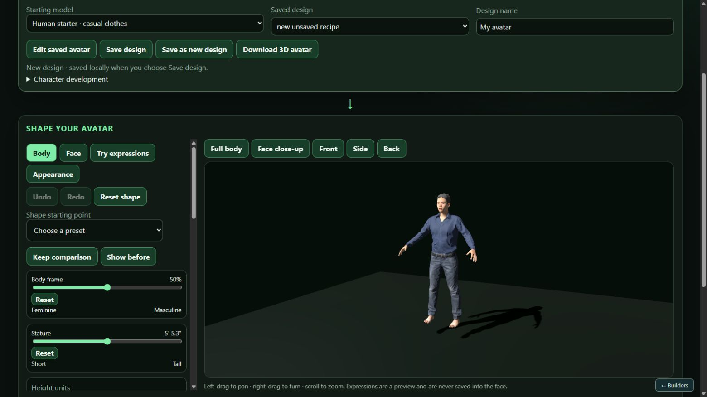
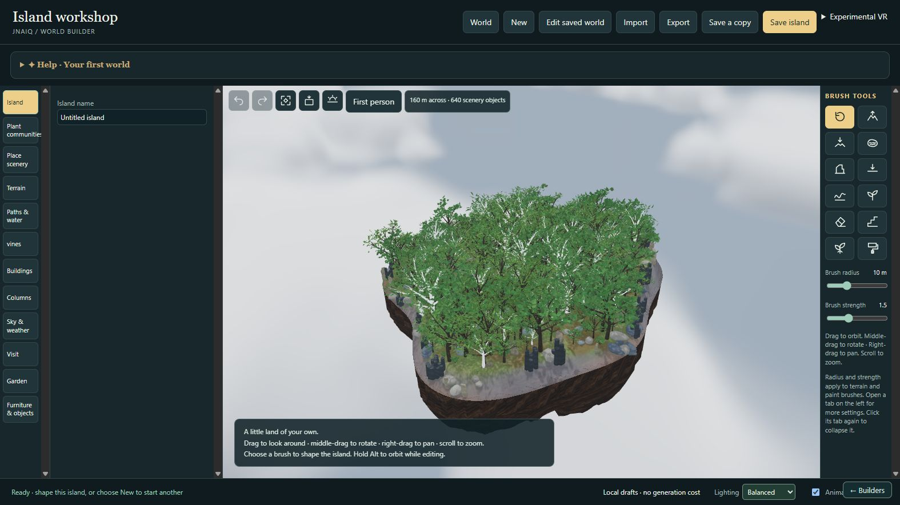

# JNAIQ Builders

Optional local **Avatar Creator** and **World Builder** for
[JNAIQ](https://github.com/several-dozen-lizards/Je-Ne-sAIs-Quoi).
Create and edit avatars and environments, save your original designs, and export
creations to use in JNAIQ. The editors also work on their own.

## A look inside

### Avatar Creator

Shape the included human starter, preview the result, and save an editable design
or export a self-contained GLB for JNAIQ.

### World Builder

Sculpt terrain, grow scenery, place objects, adjust the sky, and save or export
your world. This screenshot shows the included procedural island in daylight.

*Actual screenshots of the curated public Builders on an isolated test copy.
Experimental VR remains off; these are desktop editor views.*

## Download the curated preview

**[Download JNAIQ Builders 0.2.0-preview.1](https://github.com/several-dozen-lizards/JNSQ-Builders/releases/tag/v0.2.0-preview.1)**

Choose **Get-JNAIQ-Builders.zip** under the release's **Assets**. Use this curated
release rather than GitHub's **Code / Download ZIP** or the older full collections.
The source checkout alone does not include the required model/rendering packs.

This preview includes one finished editable human starter, six furniture objects,
landscape materials, procedural scenery, and the Godot/Three.js editor runtimes.
Unfinished model studies, extra wardrobe shelves, and assets with unverified
redistribution terms are omitted. The starter supports body/face editing, casual
clothing and short hair; you can also import your own model.

## Install on Windows

You need **Python 3.10+**, with **Add Python to PATH** enabled, and a browser that
supports WebGL. Allow about **3 GB free**: the archives total about **666 MB**,
with about **710 MB unpacked** before Python dependencies.

1. Download **Get-JNAIQ-Builders.zip** and extract it into a **new folder**.
2. Run **DOWNLOAD_BUILDERS.bat**. Keep the window open while it downloads,
   verifies and extracts all three packs. If interrupted, rerun it to reuse
   completed downloads.
3. Open the resulting **JNAIQ-Builders** folder and run **INSTALL_BUILDERS.bat**.
   This creates its local Python environment and downloads dependencies.
4. Run **START_BUILDERS.bat**. Keep its server window open while using the editors.

No model API key, JNAIQ household, Blender installation or Godot editor is
required for ordinary editing with the included assets.

**Manual alternative:** download the **application**, **avatars** and **world**
ZIPs from the same 0.2.0-preview.1 release and extract all three into the same new
parent folder. Each ZIP supplies part of **JNAIQ-Builders**. Then run
INSTALL_BUILDERS.bat and START_BUILDERS.bat inside it.

Install this preview into a fresh folder. Keep older installations and saved
libraries intact; do not extract it over them.

## Connect the editors to JNAIQ

Use [JNAIQ 0.12.3](https://github.com/several-dozen-lizards/Je-Ne-sAIs-Quoi/releases/tag/v0.12.3)
for the public avatar-assignment and world-travel workflow.

1. Start **START_BUILDERS.bat** in your Builders installation.
2. Open JNAIQ and choose **Builders**.
3. Enter the **Local port** printed in the Builders server window, normally
   **61420**, and choose **Connect to Builders**.
4. Use **Avatar Creator**, **World Builder**, **Edit saved avatar** or
   **Edit saved world** from that page.

Builders keeps its own saved work. Connecting opens the local editors; importing
an export through JNAIQ's **Worlds** page is the step that makes it available to
your household. If connection fails, check that the Builders window is still
running and that its printed port matches JNAIQ's Local port field.

## Use your creations in JNAIQ

### Avatars

In Avatar Creator, edit the starter or import a model. Choose **Save design** to
retain the editable original, then export its self-contained **GLB**. In JNAIQ's
**Worlds** page, import that GLB, select a household member, and choose
**Apply avatar**. **Restore previous** reverses an assignment.

For later edits, reopen the saved design in Builders, export again, and import
the revised GLB as a new avatar-library entry before assigning it.

### Worlds and travel

For JNAIQ's optional 3D world runtime, install [Node.js](https://nodejs.org/) and
run **INSTALL_3D_RUNTIME.bat in your JNAIQ app folder**. This is separate from
INSTALL_BUILDERS.bat in the Builders folder. It verifies about **641 MB** of
optional archives and installs only the admitted landscape/furniture assets.
The editor package itself does not host your household.

In World Builder, choose **Save island** to retain the editable original and
export **world JSON**. In JNAIQ's **Worlds** page, use **Import and publish world**,
then **Travel here**. Opening an environment view alone does not move anyone.
The visitor's Travel menu moves your local user between destinations or back to
the Nexus through JNAIQ's existing room host.

To revise a published world, reopen the original Builder save, edit and export
again, then select **Update** for the same-named world when importing in JNAIQ.
Leave an occupied world before replacing it; stale revisions are rejected.
World JSON references the matching assets rather than embedding the whole pack.

## Save, reopen and back up

**Save design / Save island** retains editable work in this Builders installation.
**Edit saved avatar / Edit saved world** reopens it. Export produces a portable
copy. Back up the **entire Builders folder**, including `data` and imported models,
before moving or updating it. JNAIQ's app updater does not update this separate
Builders installation. Getting-started help can be switched off, retires after
the first successful save, and can be reopened later.

## Experimental VR

VR is **off by default**, early, incomplete and likely clunky. **Physical-headset
compatibility has not been tested.**

- **World Builder:** open **Experimental VR**, opt in, then choose **Enter VR**.
  This provides headset viewing of the editor world; editing stays on the desktop.
- **JNAIQ published worlds:** enable **Experimental VR** in JNAIQ's Worlds page,
  open a published world, and choose **Headset**.

Use a WebXR-capable desktop browser and a compatible connected headset. The
Builders server is loopback-only, so standalone headsets cannot connect to it
over your LAN. Controller locomotion and embodied household interaction are not
qualified. Walk/idle animation packs are omitted from this curated release.

## Credits and preview status

See **THIRD_PARTY_NOTICES.md**, **ASSET_ADMISSION.json**, **ASSET_REVIEW.json** and
**BUILDERS_MANIFEST.json** in the curated package for sources, admission records
and hashes. Keep notices with shared assets. Historical releases contain different
collections and should not be treated as this curated pack.

The curated package was checked on isolated Windows copies for installation,
avatar/world rendering, edits, save/reopen and export, guide completion, and
no-headset/mocked VR lifecycle behavior. JNAIQ's import, assignment, travel and
restart workflow was checked separately. Bugs may remain; feedback and headset
compatibility reports are welcome.
